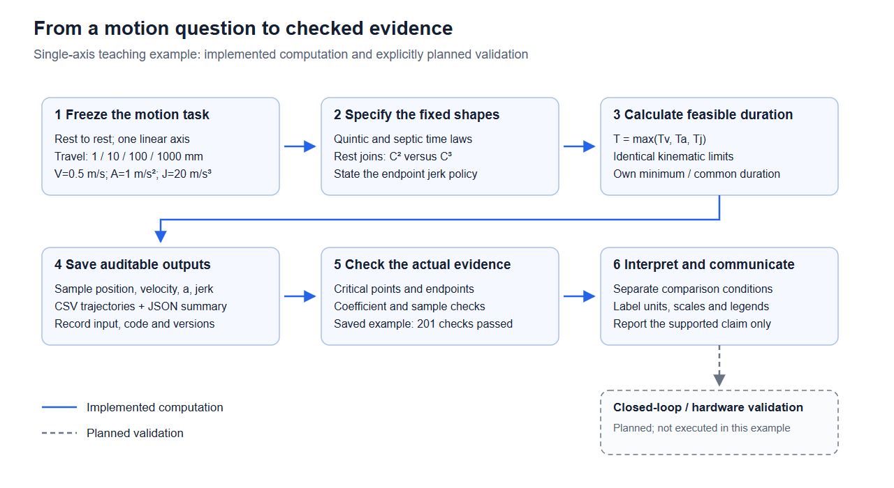
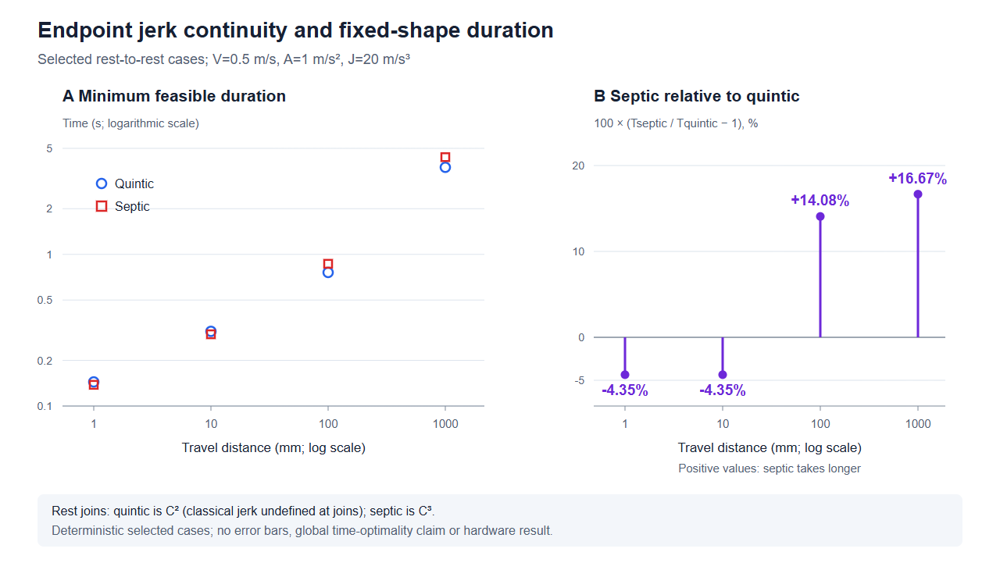
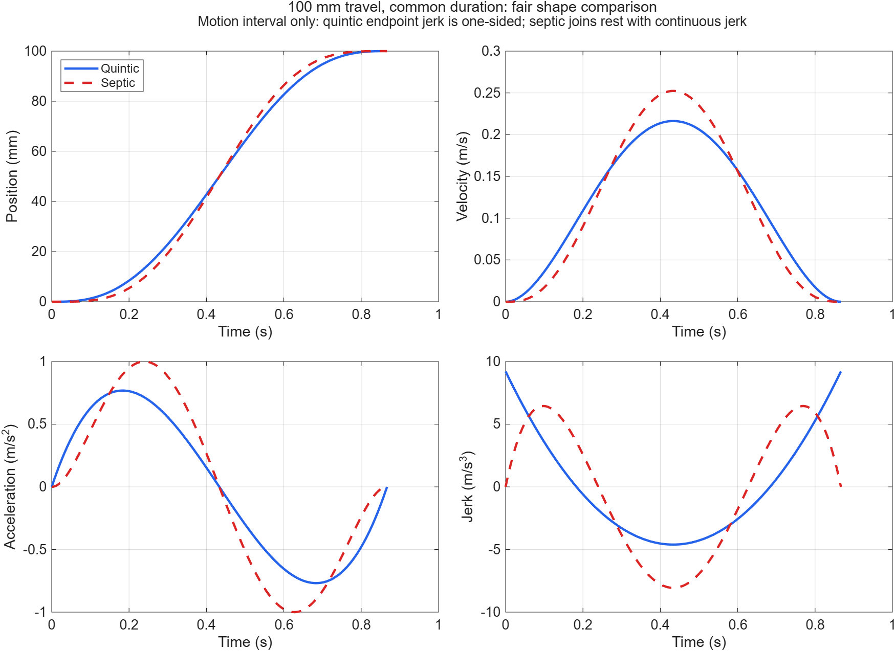
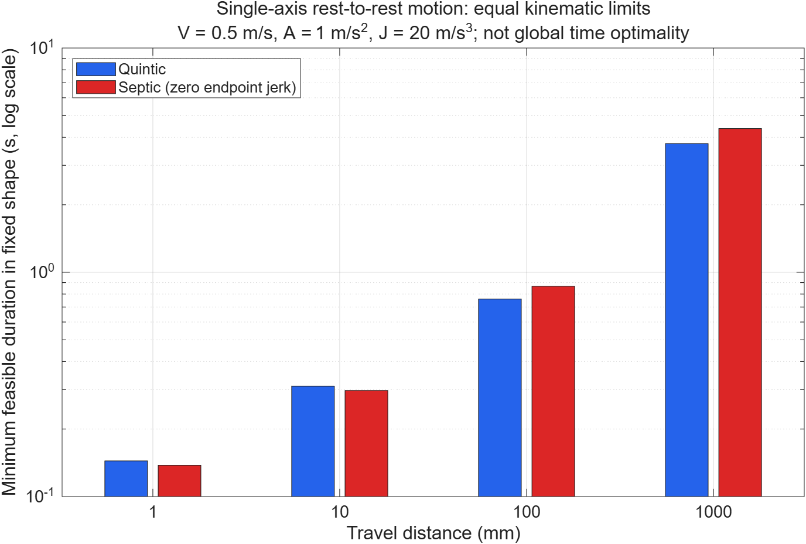

# 读图 → 配图：从轨迹曲线到自己的科研图

本例完整演示一次使用过程：提供已有图和数据 → 读懂比较条件 → 修正过度结论 → 设计配图 → 实际生成图形 → 写图注和检查结果。材料来自本仓库原创计算，不需要访问受限飞书页或下载第三方素材。

最终生成两张图。第一张把研究步骤画成方法流程；第二张用同一数据重新表达时长取舍，帮助读者看懂原有对数图中的小差别。





可编辑矢量：[方法流程图 SVG](generated/workflow-overview.svg)、[结果图 SVG](generated/duration-tradeoff.svg)。以上是实际生成的文件，英文图中文字的中文含义在下面解释。

## 1. 把这段请求发给助手

先按根目录 [README](../../README.md) 加载 Skill。已有本地安装时可直接复制：

```text
使用 $research-workflow，完成一次“读图到配图”的练习。
工作目录是本仓库根目录。

请实际查看：
examples/trajectory-planning/equal-duration-profiles.png
examples/trajectory-planning/duration-comparison.png
并核对 examples/trajectory-planning/summary.json 及 csv/ 中对应数据。

先告诉我：每张图回答什么问题、比较条件、坐标单位、图例和能支持的结论。
不要从图片估计精确数据，不预设七次轨迹胜出。

然后制作两张原创配图：
1. 方法流程图：明确任务、形状、时长计算、数据输出、检查和解释的关系；
   尚未执行的硬件验证用虚线单独标注。
2. 结果图：展示1/10/100/1000 mm工况的各族最小时长，并用线性变化率轴
   解释七次相对五次快慢多少，写明变化率公式、零线及正负含义。

保留SVG和PNG预览，提供图注、原始数据到图的对应关系、重跑步骤和质量检查。
确定性计算不要添加误差条或显著性星号。
```

尚未安装 Skill，也可以在请求开头写“请先读取 `skills/research-workflow/SKILL.md` 及其图表参考，再完成下列任务”。助手需要实际具备读图、读取文件与绘图能力；本例的生成程序也可以单独运行。

## 2. 本次实际读了什么

### 输入图A：相同时长下的轨迹形状



读图输出：这是100 mm、静止到静止、共同可行时长约0.866787 s下的位置、速度、加速度和jerk。蓝实线代表五次，红虚线代表七次；位置用mm，其余分别用m/s、m/s²、m/s³。两条曲线在相同时间完成同样位移，因此这张图主要比较形状与峰值，不能用来证明哪条更快。

图中七次端点jerk为零；与静止保持段连接时的C³连续性还依赖解析边界条件与检查记录，不能仅凭没有画出静止段的曲线图完成证明。五次接静止段仅为C²，拼接点经典jerk不存在；运动区间采用单侧／几乎处处界。

对照JSON的100 mm共同时间结果，五次／七次的绝对峰值为：速度0.216316／0.252369 m/s、加速度0.768449／1.000000 m/s²、jerk 9.213292／8.061630 m/s³。这些数值来自保存的数据，而非量取图片像素。

### 输入图B：相同上限下的各族最小时长



读图输出：该图在V=0.5 m/s、A=1 m/s²、J=20 m/s³的相同上限下，让每个固定多项式族分别采用自己的可行最小时长。纵轴为对数尺度，不能把柱长比例当成百分比；图中只展示四个正向行程，反向和零行程工况不在这幅图里。

这里需要改正“七次更平滑，所以一定更快”的推断：平滑性必须明确到连续阶次；时长排序会随行程及主导约束改变。本次计算中，1/10 mm的七次较短，100/1000 mm的七次较长。也没有硬件振动、能耗或加工质量的测量数据。

## 3. 把读图结果转成配图设计

| 产物 | 要回答的问题 | 具体设计 |
|---|---|---|
| 方法流程图 | 怎样从运动问题得到可检查的结论？ | 六个实线模块展示实际计算步骤；灰色虚线模块标出未执行的闭环／硬件验证。模块有明确名称和箭头。 |
| 结果图A面板 | 两个固定形状在四个选定工况的时长分别是多少？ | 横轴行程、纵轴时长，均明确为对数轴；圆形和方形与颜色共同区分方法，不连接离散算例。 |
| 结果图B面板 | 七次相对五次的时长究竟变化多少？ | 纵轴使用线性百分比，画零线并直接标值；正值表示七次耗时更长，负值表示更短。 |

颜色、图标和线条均为本项目自绘；没有复制原指南图片或使用第三方图库。图内的“201项检查通过”指原轨迹示例已有验证，本次绘图程序不会自动重新执行那201项检查。

精确数据来自 [summary.json](../trajectory-planning/summary.json) 中四个工况的 `families.quintic.minimum_duration_s` 与 `families.septic.minimum_duration_s`，并导出为 [plot-data.csv](generated/plot-data.csv)。变化率按下式计算：

```text
七次相对五次的时长变化率 = (七次时长 / 五次时长 − 1) × 100%
```

| 行程(mm) | 五次时长(s) | 七次时长(s) | 七次相对变化 | 主导约束 |
|---:|---:|---:|---:|---|
| 1 | 0.144225 | 0.137946 | −4.35% | jerk |
| 10 | 0.310723 | 0.297196 | −4.35% | jerk |
| 100 | 0.759836 | 0.866787 | +14.08% | acceleration |
| 1000 | 3.750000 | 4.375000 | +16.67% | velocity |

## 4. 实际运行并复现

Python 3.10+、仅标准库，无需安装绘图库。在仓库根目录运行：

```text
python examples/figure-reading-and-design/make_figures.py --summary examples/trajectory-planning/summary.json --output rerun/figure-reading-and-design
```

实际运行成功，得到两张SVG、一份CSV、检查JSON和运行清单。程序固定服务于这个已标明条件的示例；更换V/A/J或图意时，应同时更新设计与标签，不把它当作任意实验的通用绘图器。输出目录应为空，或是同一程序对同一输入的已有输出目录。

打开生成的SVG即可查看和编辑；浏览器通常可以直接查看。仓库中的PNG是以1280像素宽、分别700和730像素高在Chromium中实际渲染的预览。Python程序只生成SVG和数据，不自动生成PNG；本例不将这些预览声明为满足某期刊分辨率的成稿。

文件对应关系：

| 文件 | 用途 |
|---|---|
| [make_figures.py](make_figures.py) | 实际运行过的原创生成程序。 |
| [manifest.json](generated/manifest.json) | 输入、脚本与输出SHA256及实际调用参数。 |
| [quality-checks.json](generated/quality-checks.json) | 输入、数据派生和SVG解析检查；含未验证项。 |
| [example-validation.json](example-validation.json) | 本轮实际运行、跨文件核对、预览散列与人工审图记录。 |

原轨迹数据的独立系数检查器需要另行运行，命令见 [轨迹实验报告](../trajectory-planning/report.md)。本例复用已经通过核查的数据，没有重复宣称新增201项独立研究。

## 5. 可以怎样写图注

**方法流程图：**单轴静止到静止运动的科研工作流示意。实线步骤由任务定义、固定多项式形状、可行时长计算、数据保存、约束核查和结果解释组成；虚线连接的闭环／硬件验证为计划内容，本例尚未执行。

**结果图：**相同速度、加速度和运动区间内／几乎处处jerk上限下，五次与七次固定多项式时间律的可行最小时长。A：四个选定正向行程的时长点，行程与时间均使用对数轴。B：七次相对五次的时长变化率，纵轴为线性百分比，正值表示七次耗时更长。五次与静止段拼接为C²，七次为C³。结果限于所列固定形状与工况，不代表一般轨迹的全局时间最优性或硬件性能。

## 6. 本例完成了哪些检查

实际核对了四行数据与JSON、变化率的分母与符号、图内标值、对数／线性轴说明、图例和模块箭头，查看两张PNG，并确认SVG可解析、运行散列一致。独立审阅者另外检查了输入图的结论范围和最终成图。

尚未验证：目标期刊的物理尺寸与字体、正式色觉缺陷模拟、闭环控制和硬件效果。原始研究仍限于固定单轴多项式族。新例只增加可复现的图文教学和绘图表达，不扩张科研结论。
