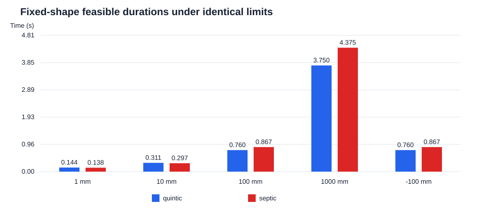
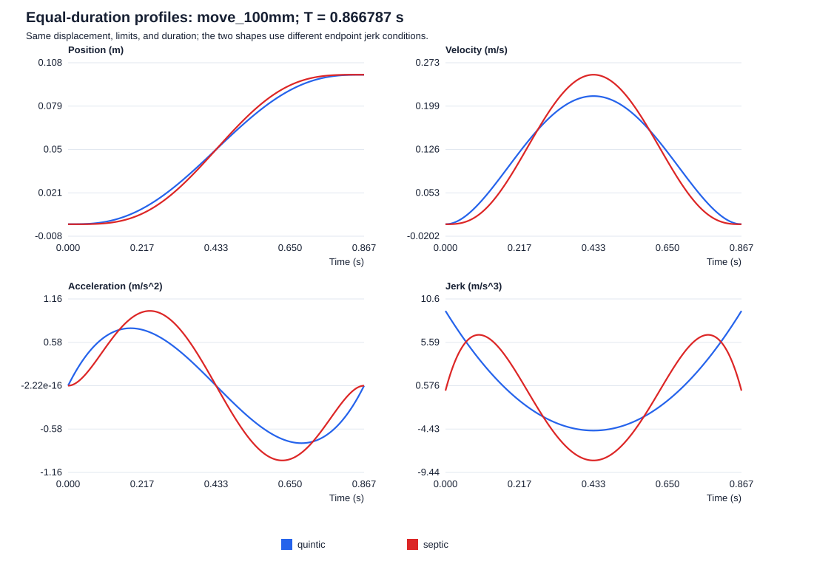

# 单轴多项式轨迹规划：可复现科研小实验

研究问题：在同一位移、速度/加速度/jerk 绝对值上限下，固定五次与七次多项式轨迹的最小可行时长如何变化？七次轨迹额外要求两端 jerk 为零。

**结论范围：这是两个固定形状族的时间缩放比较，不是全局时间最优求解，也不是机器人或机床硬件性能结论。**

## 输入与假设

- SI 单位：位移 m，时间 s；速度上限 0.5 m/s，加速度上限 1 m/s²，jerk 上限 20 m/s³。
- 单轴运动，初末速度、加速度均为零；起点和终点之间采用单调多项式，不含障碍物、力矩、伺服、共振、采样控制器、轴间同步或拐角拼接模型。
- 真实控制器必须另外核实插补周期、位置精度、轴耦合与驱动饱和。本实验不声称论文新颖性。

## 原创推导

令 u=t/T，Δq=q₁−q₀，D=|Δq|。q(t)=q₀+Δq·f(u)。

五次：f₅(u)=10u³−15u⁴+6u⁵。七次：f₇(u)=35u⁴−84u⁵+70u⁶−20u⁷。

由 v=Δq f′/T、a=Δq f″/T²、j=Δq f‴/T³，在 [0,1] 上检查导数零点和端点，得到：

| 形状 | 速度峰值 Cᵥ | 加速度峰值 Cₐ | jerk 峰值 Cⱼ |
|---|---:|---:|---:|
| 五次 | 15/8 | 10/√3 | 60 |
| 七次 | 35/16 | 84/(5√5) | 105/2 |

五次速度峰值在 u=1/2；加速度绝对峰值在 u=(3±√3)/6；jerk 绝对峰值在 u=0、1（中点值 −30）。
七次速度峰值在 u=1/2；加速度绝对峰值在 u=(5±√5)/10；jerk 的内部极值在 u=(5±√15)/10、1/2，对应值 42、−105/2、42，端点为零。

对每个固定形状，T*=max(D·Cᵥ/Vmax, √(D·Cₐ/Amax), ∛(D·Cⱼ/Jmax))。
必要性来自三个峰值约束；充分性来自这些峰值已经覆盖整个连续区间。每个峰值随 T 增大而按 T⁻¹、T⁻²、T⁻³ 单调减小，因此该最大值就是该形状族的最小可行时长。D=0 采用 T=0 的静止约定。

## 结果

| 工况 | 位移 m | 五次 T* s | 主导约束 | 七次 T* s | 主导约束 | (七次/五次−1) |
|---|---:|---:|---|---:|---|---:|
| move_1mm | 0.001 | 0.144224957 | jerk | 0.137946209 | jerk | -4.35% |
| move_10mm | 0.01 | 0.310723251 | jerk | 0.297196098 | jerk | -4.35% |
| move_100mm | 0.1 | 0.759835686 | acceleration | 0.866786502 | acceleration | +14.08% |
| move_1000mm | 1 | 3.750000000 | velocity | 4.375000000 | velocity | +16.67% |
| reverse_100mm | -0.1 | 0.759835686 | acceleration | 0.866786502 | acceleration | +14.08% |
| stationary | 0 | 0.000000000 | stationary | 0.000000000 | stationary | 不适用 |





本输入下，短行程可能由 jerk 约束主导，中行程可能由加速度主导，长行程可能由速度主导。七次多项式的归一化 jerk 峰值更低，但速度和加速度峰值更高，因此不保证时长更短。请以上表实际主导约束为准。

每个工况还提供共同时间 T_common=max(T*₅,T*₇) 的两条轨迹，避免仅比较不同完成时刻的曲线。summary.json 同时记录各自最小时长与共同时间下的全部解析峰值；csv/ 提供两种模式的采样数据。

## 端点 jerk 与静止延拓

五次轨迹在运动区间内部的两端单侧 jerk 为 60Δq/T³，静止段 jerk 为零。与静止段拼接后，位置函数属于 C²；经典三阶导数在拼接点不存在，但几乎处处有界的弱 jerk 不含冲量，因为加速度连续。只要求区间内或几乎处处 jerk 上界时，本实验五次方案满足上限；若要求全局连续 jerk 或拼接点处经典 jerk 存在，五次方案不满足。
七次轨迹端点 jerk=0，与静止段拼接后属于 C³；snap 仍可跳变。额外端点条件改变了候选族，因此比较不能证明任何一族整体优于另一族。

## 质量检查与复现

本次独立检查：**201/201 通过**（详见 quality-checks.json）。
生成器使用解析峰值常数；独立检查器从多项式系数递归隔离导数根，再核查整个 [0,1] 上的极值、所有 CSV 样点、端点、时间排序、正反向工况及轻微缩短后的约束违反。浮点计算和数值根隔离属于数值审计，不是形式化证明；解析推导另见上文。
采样数据用于复现和画图，采样本身不能证明连续时间约束。manifest.json 记录原始输入、实际运行输入和脚本 SHA-256、Python 版本、UTC 运行时间及输出文件哈希。

在 Skill 目录执行：

```text
python scripts/trajectory_benchmark.py --input assets/trajectory-input.json --output ../../examples/trajectory-planning
python scripts/verify_trajectory.py --input assets/trajectory-input.json --output ../../examples/trajectory-planning
```

输出目录可改为任意新的目录。仓库根目录执行 python -m unittest discover -s tests -v；本报告不将单元测试未执行的状态描述为通过。

## 后续可证伪假设

在包含拐角和多轴同步的实际轨迹上，连续 jerk 端点是否降低跟踪误差，必须结合相同控制器、采样周期、路径公差、负载和硬件实验验证。当前输出只支持固定形状的运动学比较。
